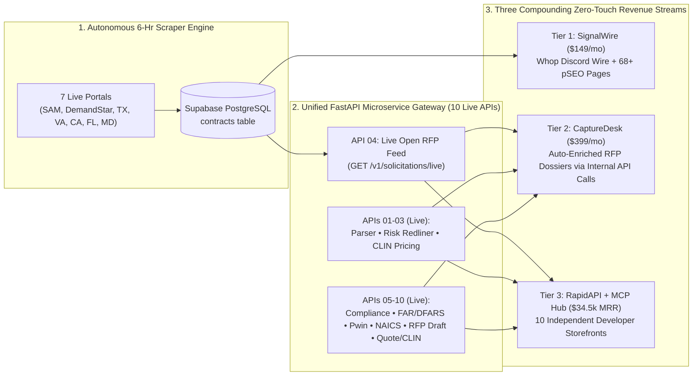

# SignalTender $1M ARR Autonomous DaaS Master Plan
**Operating Constraint:** `< 2 hours/week` of human oversight (100% compatible with full-time day job & academic studies)  
**Target Scale:** `$1,020,000+ ARR` (`$85,000+ MRR`)  
**Sales Motion:** `0% Synchronous` (Zero demos, zero discovery calls, zero custom enterprise retainers, zero manual onboarding)

---

## 1. Critique of the Previous AI Business Plan (Why It Would Cap Out at ~$5k–$10k MRR)

1. **The $99/mo High-Churn Treadmill:** Needing **500 active low-ticket customers** ($99–$149/mo) means fighting an 8%–12% monthly SMB churn rate. At 10% monthly churn, you must acquire **50 brand-new paying customers every single month** just to stay flat.
2. **Mispriced API Model ($0.01/call vs. Tiered Multi-API Portfolio):** Projecting **2,500,000 API calls/month at $0.01/call** on a single endpoint is unrealistic in niche B2B and destroys LLM token margins. Instead, scaling a **portfolio of 10+ specialized B2B/GovCon APIs** on `$49–$299/mo` RapidAPI subscription tiers creates compounding recurring revenue with 90%+ gross margins.
3. **Underpricing in a High-Ticket Vertical:** Legacy GovCon platforms (GovWin IQ / Deltek, HigherGov, Bloomberg Gov) charge **$12,000 to $35,000/year**. Charging $99/mo for a single global Discord channel leaves 80% of corporate-card willingness-to-pay on the table.
4. **Hidden Manual Labor:** Exporting CSVs from Apollo by hand and maintaining brittle DOM scrapers would turn into a 20-hour/week job during midterms or work sprints unless the pipeline is built on **stateless API microservices** and **autonomous outbound**.

---

## 2. The New $1M ARR Equation: Multi-API Portfolio + Self-Serve Capture Tiers

Because all of your FastAPI microservices run on **one unified Render gateway** (`b2b-contract-parser-api.onrender.com`), every new API you launch costs **$0 in extra hosting** while acting as a brand-new organic storefront on RapidAPI and MCP registries.

| Revenue Pillar | Self-Serve Product | Price Point | Target Active Volume | Monthly Recurring Revenue (MRR) | Annualized Run Rate (ARR) |
| :--- | :--- | :--- | :--- | :--- | :--- |
| **Tier 1: SignalWire Pro** | Real-Time Multi-State SLED + Federal Discord/Email Alert Wire (via Whop) | **$149 / mo** *(or $1,490/yr)* | **120 seats** | **$17,880** | **$214,560** |
| **Tier 2: CaptureDesk Autopilot** | State/NAICS Filtered Webhook + **Automated Multi-API Capture Dossiers** per RFP | **$399 / mo** *(or $3,990/yr)* | **85 teams** | **$33,915** | **$406,980** |
| **Tier 3: 10+ API & MCP Portfolio** | **10–12 Stateless B2B/GovCon APIs** on RapidAPI (`Pro` $49, `Ultra` $149, `Mega` $299) | **~$150 / mo avg** *(~23 subs per API)* | **230 API subscriptions** *(across 10 APIs)* | **$34,500** | **$414,000** |
| **TOTAL** | **100% Self-Serve (Whop + RapidAPI + MCP)** | **~$198 Blended ARPU** | **435 Total Subscriptions** | **$86,295 / mo** | **$1,035,540 / yr** |

---

## 3. The 10-API Portfolio Roadmap (One FastAPI Gateway, 10 RapidAPI Storefronts — ALL 10 LIVE)

| API # | Endpoint & RapidAPI Product Name | What It Does (Stateless Input -> Output) | Target RapidAPI Buyer |
| :--- | :--- | :--- | :--- |
| **01 (Live)** | `POST /v1/parse/contract` **B2B Contract Parsing API** | Converts raw RFP/SOW text into structured `ContractExtraction` JSON (budget, deadline, deliverables, clearances). | CRM & GovCon SaaS developers |
| **02 (Live)** | `POST /v1/parse/contract-risks` **AI Contract Risk & Redline Auditor API** | Audits MSAs/NDAs/Subcontracts for toxic clauses and outputs verbatim quotes + ready-to-paste legal redlines. | LegalTech, CLM tools, Deal Desks |
| **03 (Live)** | `POST /v1/awards/search` **Historical Procurement Pricing API** | Queries federal contract awards, prime contractor win histories, and CLIN unit pricing by NAICS/UEI/keyword. | Price-to-Win (PTW) & BI analysts |
| **04 (Live)** | `GET /v1/solicitations/live` **Live SLED & Federal Open RFP Feed API** | Exposes your live, AI-vetted 7-portal Supabase `contracts` table via REST filters (`state`, `category`, `closing_after`). | AI sales agents & GovCon dashboards |
| **05 (Live)** | `POST /v1/generate/compliance-matrix` **RFP Compliance Matrix & Proposal Outline API** | Takes raw RFP Section C/L/M or SOW text and outputs a Shipley-aligned **`shall`/`must` Compliance Checklist**, Section L-to-M cross-reference mapping, and hierarchical **Proposal Outline** with page allocations & win themes. | Proposal automation software & bid writers |
| **06 (Live)** | `POST /v1/audit/far-dfars-clauses` **FAR / DFARS & CMMC Clause Risk Scanner API** | Detects every Federal Acquisition Regulation (`FAR 52.2xx` / `DFARS 252.2xx`) clause in a solicitation, flags flow-down mandates, and scores CMMC/FedRAMP compliance burden. | Defense contractors & compliance platforms |
| **07 (Live)** | `POST /v1/match/capability-statement` **AI Bid/No-Bid & Capability Matcher API** | Accepts `(rfp_text, company_past_performance)` and outputs a **0–100 Pwin (Probability of Win) Score**, gap analysis, and tailored executive summary pitch. | GovCon capture teams & AI SDRs |
| **08 (Live)** | `POST /v1/classify/naics-psc-nigp` **NAICS, SIC, PSC & UNSPSC Industry Classifier API** | Maps any product description, SOW, or company website text to exact 6-digit **NAICS**, **SIC** (for KYB/FinTech lending), Federal **PSC**, and State **NIGP/UNSPSC** codes with confidence scores & SBA size standard thresholds. | FinTech KYB, ERP, and vendor-onboarding platforms |
| **09 (Live)** | `POST /v1/generate/rfp-response` **AI RFP Response & Clarification Q&A Generator API** | Drafts a Shipley-compliant **Technical Proposal Section** from company context AND generates **strategic vendor clarification Q&A** to expose ambiguous or competitor-wired specs. | Proposal teams, capture managers & AI bid platforms |
| **10 (Live)** | `POST /v1/extract/pricing-schedule` **B2B Quote, Invoice & CLIN Table Extractor API** | Extracts messy multi-tier pricing tables, labor rate cards (LPTA/T&M), and BOM spreadsheets from unstructured vendor quotes into normalized JSON. | FinOps, procurement teams & ERP integrators |

---

## 4. How the Flywheel Connects All 3 Tiers Automatically

---

## 5. Phased Execution Plan (< 2 Hours/Week Effort)

| Phase | Timeline | Primary Milestone | Weekly Time | Target MRR |
| :--- | :--- | :--- | :--- | :--- |
| **Phase 1: Foundation, pSEO & 10-API Portfolio** | **COMPLETED** | • **DONE:** 7 State/Federal scrapers live & memory-isolated in `mainscraper.py` • **DONE:** `pseo_generator.py` building 68+ static SEO pages + `sitemap.xml` (verified in Google Search Console) • **DONE:** All **10 Stateless FastAPI Microservices (APIs 01–10)** live on Render, listed on RapidAPI, and integrated across `signaltender.net` | **~0.5 hrs/week** | **$0 – $2,500** |
| **Phase 2: Cold Email Launch + CaptureDesk Autopilot** | **Nov – Month 3** | • Cold email domains finish warmup; launch `outreach_generator.py` campaigns (Instantly/Smartlead auto-sync ready) • Chain APIs 01–10 internally to power the **$399/mo CaptureDesk Autopilot** tier on Whop | **~1.5 hrs/week** | **$5,000 – $25,000** |
| **Phase 3: MCP Server Registry Distribution** | **Months 3 – 6** | • Bundle all 10 APIs into `@signaltender/mcp-server` so Claude Desktop, Cursor, and Windsurf users can discover and call your 10 endpoints natively via RapidAPI keys | **~1 hr/week** | **$25,000 – $50,000** |
| **Phase 4: Compounding Scale & Affiliate Flywheel** | **Months 6 – 18** | • Scale Whop 30% recurring affiliate network + annual plans + additional SLED state portals / vertical APIs | **< 1 hr/week** | **$86,000+ ($1M+ ARR)** |
